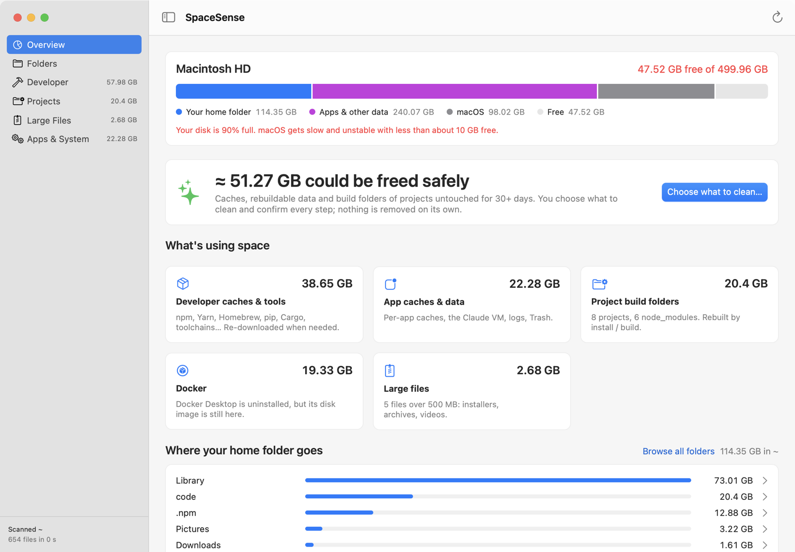
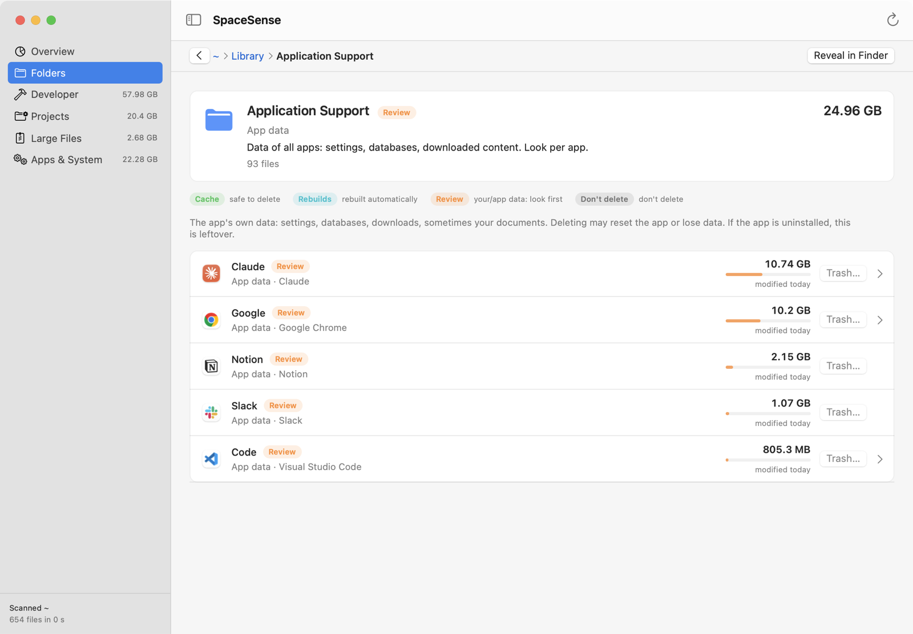
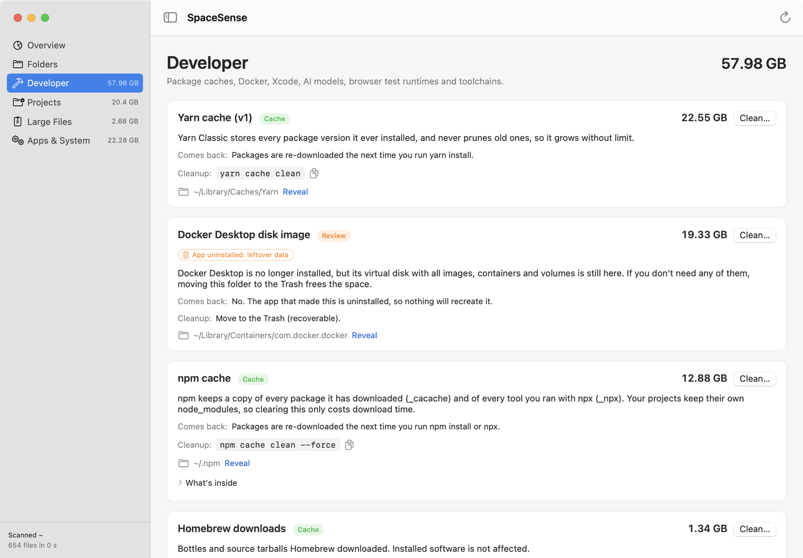
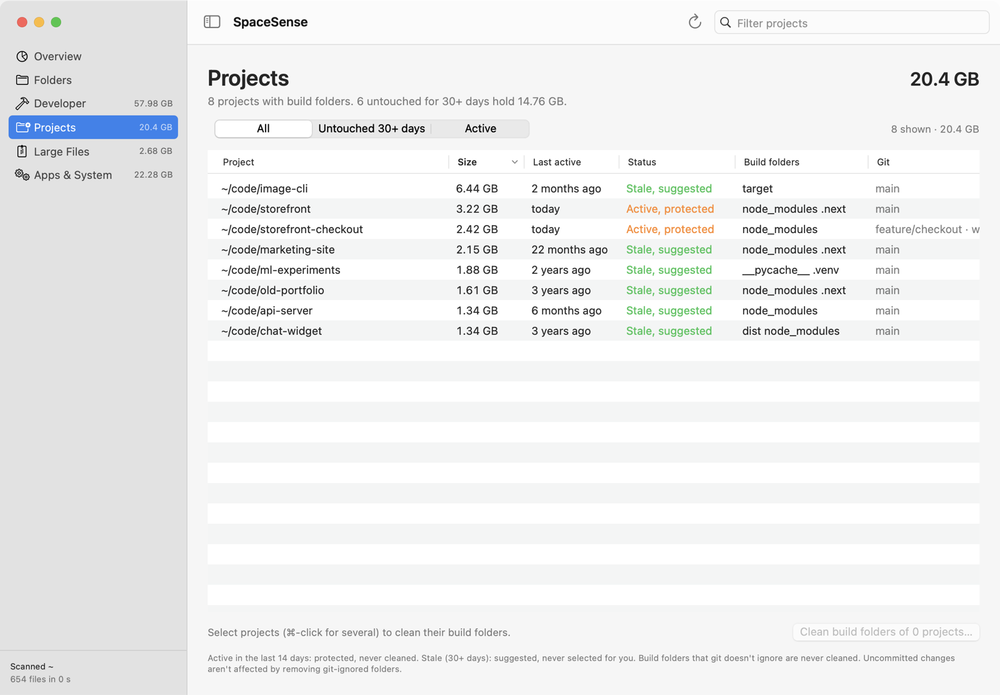
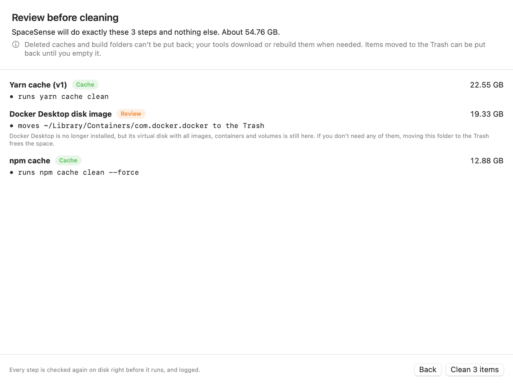

# SpaceSense

**A free, open-source Mac app that explains what is filling your disk, and cleans it safely.**
Built for developers: it knows `node_modules`, npm / Yarn / pnpm / Bun caches, Docker,
Xcode, Homebrew, Cargo, pip / uv, AI models, Playwright and Puppeteer browsers, and git
worktrees.

> Status: early (v0.1). Universal (Apple Silicon + Intel), macOS 13 or later.



<table>
<tr>
<td width="50%"><br><sub><b>Folders</b>: every folder with its owning app and a verdict: Cache, Rebuilds, Review or Don't delete.</sub></td>
<td width="50%"><br><sub><b>Developer</b>: package caches, Docker, toolchains, AI models, each with what it is, whether it comes back, and the official command.</sub></td>
</tr>
<tr>
<td width="50%"><br><sub><b>Projects</b>: node_modules, target/, .venv… per project, with last activity and git state. Active projects are protected.</sub></td>
<td width="50%"><br><sub><b>Review</b>: nothing runs until you've seen every exact step and confirmed.</sub></td>
</tr>
</table>

<sub>Screenshots use a demo home folder (<code>docs/demo-home.sh</code>), not a real one.</sub>

## Install

1. Download `SpaceSense-<version>.dmg` from [Releases](https://github.com/amarpathak/spacesense/releases)
   and drag SpaceSense to Applications.
2. The app isn't notarized by Apple yet, so the first launch shows *"Apple could not
   verify SpaceSense…"*. Click **Done**, open **System Settings → Privacy & Security**,
   scroll down and click **Open Anyway** next to SpaceSense. You only do this once.
3. Optional: give it **Full Disk Access** (System Settings → Privacy & Security → Full
   Disk Access → **+** → SpaceSense) so it can also measure the Trash, Mail, Safari and
   backups. Without it, those just aren't counted.

## Why

macOS shows a grey "System Data" bar and little else. Generic cleaners either scare you
or delete without explaining. SpaceSense tells you, for every folder:

- **what it is** and which app it belongs to (including apps you've uninstalled);
- **whether it's safe to delete**: *Cache* (safe), *Rebuilds* (regenerated by your
  tools), *Review* (your or an app's data: look first), *Don't delete* (keys, Mail,
  Photos, backups);
- **what deleting costs** ("re-downloads 10 GB next launch") and the exact command.

On the author's 500 GB Mac it found ~100 GB to reclaim: a 24 GB Yarn cache, a 15 GB npm
cache, 40 GB of `node_modules` across 110 projects, a 20 GB disk image left behind by an
uninstalled Docker Desktop, and Chrome's 8.5 GB on-device AI model.

## Safety: a person is always in the loop

- **Nothing is ever deleted automatically.** Nothing is preselected; you tick items,
  review every exact path and command, then confirm. No background or scheduled cleaning.
- Official cleanup commands first (`yarn cache clean`, `brew cleanup`, …).
- Caches and build folders are deleted; **your files only ever go to the Trash**.
- Every step is re-checked on disk right before it runs: inside your home folder, not a
  symlink, not a protected location, required apps quit, project build folders still
  ignored by git. Projects you touched in the last 14 days are protected.
- Every step is logged to `~/Library/Logs/SpaceSense/operations.log` with the space
  actually freed (measured, not estimated).
- Scanning is read-only, never downloads iCloud files, and skips cloud storage folders.

## Fast and exact

A parallel Rust scanner using `getattrlistbulk(2)`. Sizes are real disk usage (like
`du`), hard links counted once, one volume only. On 4.2 M files: 19.6 s vs `diskus`
29 s and `du` 185 s, with totals equal to `du -sk`. See [`bench/`](bench/).

## Build from source

Needs macOS 13+, the Xcode Command Line Tools (Swift 5.8+) and Rust.

```sh
app/build.sh                         # → app/build/SpaceSense.app
cargo build --release -p spacesense  # CLI: target/release/spacesense
```

CLI:

```sh
spacesense report              # what's using space, with explanations
spacesense clean --dry-run     # suggestions; changes nothing
spacesense clean npm-cache     # shows the exact steps, asks you to type "yes"
```

## How it's built

`core/` Rust engine (scanner, catalog, project detector, planner, cleaner) ·
`core/catalog/*.toml` one rule per cache or tool, with paths, safety and commands ·
`cli/` command-line tool · `ffi/` C ABI · `app/` SwiftUI app. See [PLAN.md](PLAN.md).

Sibling project: [FanBoost](https://github.com/amarpathak/fanboost).

## License

MIT
